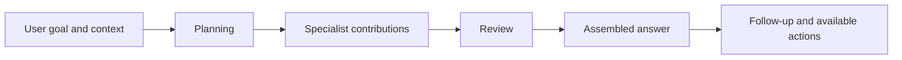

# OYYO Teams

### Bring the right specialists together around one goal.

**7 built-in workflow groups · 50 specialist team presets · 536 available roles · Reusable team profiles**

**Available for private demos and private beta. [Request early access](https://oyyo.one/contact).**

[OYYO](https://oyyo.one) · [Contact](https://oyyo.one/contact) · [Ecosystem index](docs/ECOSYSTEM.md)

Teams coordinate specialist contributions, review and a usable final result. The workflow labels and core roles below match the current workspace definitions. User-created teams and profiles are private configuration and are not published here.

## Built-in teams

| Workspace workflow | Core role sequence |
| --- | --- |
| [Everyday work](teams/general.md) | Planner → Specialist → QA reviewer → Editor |
| [Marketing team](teams/marketing.md) | Marketing strategist → Copywriter → Marketing reviewer → Editor |
| [Finance team](teams/finance.md) | Financial analyst → Financial modeler → Finance reviewer → Editor |
| [People & HR team](teams/hr.md) | HR planner → HR specialist → HR reviewer → Editor |
| [Engineering team](teams/engineering.md) | Technical planner → Engineer → QA reviewer → Editor |
| [Research team](teams/research.md) | Research planner → Research analyst → Evidence checker → Editor |
| [Operations team](teams/operations.md) | Operations planner → Operations specialist → Operations reviewer → Editor |

## Specialist team presets

Browse [all 50 specialised team presets](docs/SPECIALIST-TEAMS.md). A compatible workspace can sync these independently and save a selected preset as a private editable team. Existing saved configurations are preserved.

## What you can configure

- A reusable custom team with one to four selected specialist roles and a reviewer.
- The relevant department workflow, team instructions and bounded parallel-specialist preference.
- A profile for tone, output format, team and reusable context preferences.
- Per-agent model choices and instructions, subject to model eligibility and available resources.
- Explicit selections through the workspace composition and `@` controls.

Configuration changes apply to future assignments; a run keeps its selected configuration snapshot. A team can use one model across several role passes or assign different eligible models. More roles do not automatically improve every answer.

## Collaboration flow

Simple requests can remain direct. The displayed execution plan is the authority for what was actually assigned and completed. Planned, queued and failed work must not be presented as completed.

[Configuration and profiles](docs/PROFILES.md) · [Deliverables and handoffs](docs/HANDOFFS.md)

## OYYO public catalogs

| Repository | Discover |
| --- | --- |
| [OYYO Models](https://github.com/vpicciuolo/oyyo-models) | Model lineup, specializations, requirements and capability guides |
| [OYYO Agents](https://github.com/vpicciuolo/oyyo-agents) | All 536 workspace agent roles, department coverage and specialist functions |
| [OYYO Teams](https://github.com/vpicciuolo/oyyo-teams) | Seven built-in workflow groups, collaboration, review and reusable configurations |
| [OYYO Task Library](https://github.com/vpicciuolo/oyyo-task-library) | 1,361 guided tasks, specialist briefs and 204 creative style options |
| [OYYO Benchmark](https://github.com/vpicciuolo/oyyo-benchmark) | Evaluation methodology, qualification and reproducibility |
| [OYYO SDK](https://github.com/vpicciuolo/oyyo-sdk) | Developer interfaces and integration documentation |

## About OYYO

OYYO is a proprietary AI workspace combining task understanding, model routing, specialist roles, reusable profiles and teams, memory and tools. Public documentation describes the current catalog and its boundaries; it does not grant access to proprietary implementation or imply that every listed action executes without its required tool and permissions.

**Available for private demos and private beta. [Request early access](https://oyyo.one/contact).**

**Copyright © 2026 OYYO · HRN INNOVATION TECHNOLOGIES LTD. All rights reserved.**

## Main OYYO documentation

[OYYO ONE AI documentation hub](https://github.com/vpicciuolo/oyyo-one-ai) · [OYYO website](https://oyyo.one) · [Exclusive preview](https://oyyo.one/contact)

